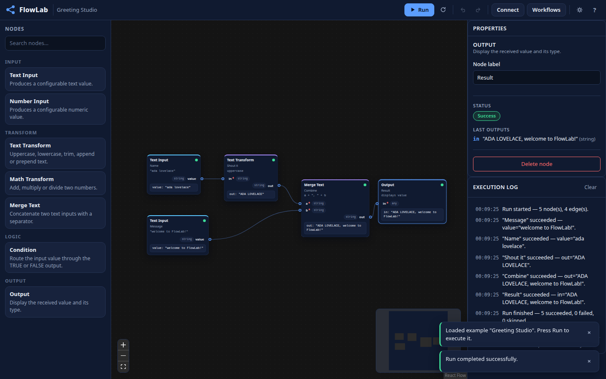
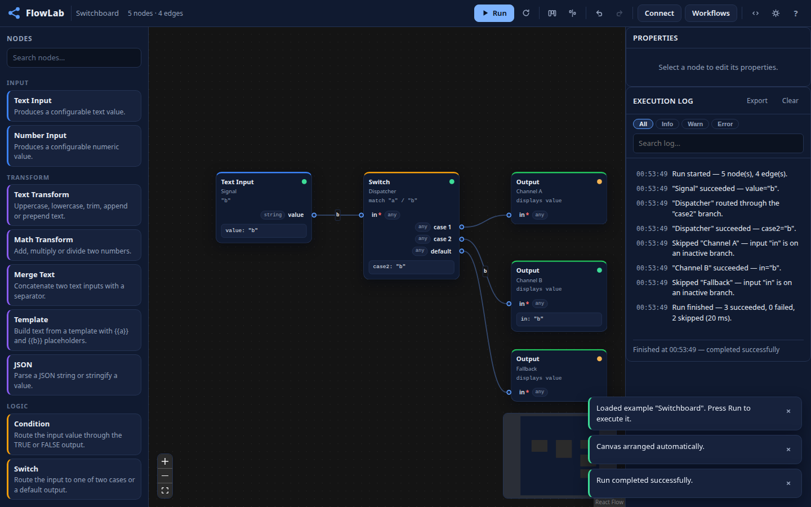

# FlowLab — Visual Workflow Builder

A fully functional, **local-first** visual workflow automation editor inspired by
n8n and Node-RED — with a **real workflow execution engine**, not a mockup.

**Live demo:** https://lexiol351.github.io/flowlab/




## Features

- **Visual node editor** — drag nodes from the palette, connect typed ports,
  move/select/duplicate/delete, zoom/pan/fit, minimap, grid snapping,
  auto-layout, align tools, copy/paste, arrow-key nudging.
- **Real execution engine** — topological ordering, cycle detection, typed port
  validation, conditional branching, multi-input gating, per-node status,
  ordered execution log, abort/reset, run timeout guard. Async node support.
  Independent of React; fully unit-tested.
- **15 functional node types** — Text/Number Input, Text Transform, Math
  Transform, Condition (branching), Switch (3-way routing), Merge Text,
  Template (string interpolation), JSON (parse/stringify), HTTP Request (real
  fetch), Delay (abort-aware), Random, Date & Time, Note (annotation), Output.
- **Validated connections** — incompatible types can't connect (by drag *or*
  via the accessible Connect dialog); would-be cycles are rejected up front;
  compatible ports highlight while dragging.
- **Live run feedback** — progress counter, transmitted values shown on edges,
  per-node timing in the log.
- **Undo/redo** with keyboard shortcuts; **command palette** (Ctrl+K).
- **Validation warnings** — dead-end nodes are flagged ⚠ without blocking runs.
- **Persistence** — autosave to IndexedDB, multiple named workflows with
  descriptions and search, rename/duplicate/delete, JSON export/import
  (including drag-and-drop onto the canvas) with runtime validation and
  corrupted-data recovery, versioned schema with tested migrations.
- **Run history** — last 10 runs per workflow with duration and outcome;
  execution log with level/text filters and JSON export.
- **6 built-in example workflows** ready to run.
- **Dark/light themes**, category color accents, responsive layout, keyboard
  shortcuts, toasts, offline indicator, reduced-motion support.
- **PWA** — installable (with install prompt), works fully offline after first load.

## Quick start

```bash
npm ci
npm run dev        # dev server
npm run build      # production build
npm run preview    # serve the production build
```

Open http://localhost:5173/flowlab/ (dev server respects the `/flowlab/` base).

## Scripts

| Script              | What it does                                      |
|---------------------|---------------------------------------------------|
| `npm run dev`       | Vite dev server                                   |
| `npm run build`     | Typecheck + production build                     |
| `npm run lint`      | ESLint                                            |
| `npm run typecheck` | `tsc -b`                                          |
| `npm run test`      | Vitest unit + integration tests                   |
| `npm run test:coverage` | Vitest with coverage gates (≥80% on core)    |
| `npm run test:e2e`  | Playwright E2E against the production build      |

## Testing

```bash
npm run test:coverage   # 100+ unit/integration tests, coverage thresholds enforced
npm run test:e2e        # real Chromium: create → connect → run → branch →
                        # reload → export/import → invalid-connection rejection
```

Playwright needs Chromium once: `npx playwright install chromium`.

## Keyboard shortcuts

| Shortcut               | Action                          |
|------------------------|---------------------------------|
| `Ctrl/⌘ + Z`           | Undo                            |
| `Ctrl/⌘ + Shift + Z` / `Ctrl/⌘ + Y` | Redo               |
| `Ctrl/⌘ + D`           | Duplicate selected nodes        |
| `Delete` / `Backspace` | Delete selected nodes           |
| `Ctrl/⌘ + Enter`       | Run workflow                    |
| `Esc`                  | Close dialogs / clear selection |

## Architecture

See [ARCHITECTURE.md](ARCHITECTURE.md) for module layout, engine semantics,
and key decisions. The workflow file format is documented in
[docs/workflow-schema.md](docs/workflow-schema.md).

```
src/lib/workflow/   engine, node registry, validation, history, migrations
src/lib/db/         IndexedDB persistence
src/lib/store/      Zustand store (sole bridge between UI and engine/DB)
src/components/     React UI (editor, panels, dialogs)
```

## Deployment

`main` branch → GitHub Actions **CI** (lint, typecheck, tests + coverage,
build, Playwright E2E) → on success **Deploy** builds and publishes to
GitHub Pages via the official `deploy-pages` action, then verifies HTTP 200.
Version tags (`v*`) trigger the **Release** workflow, which attaches a ZIP of
the production build to a GitHub Release.

## Tech stack

React 19 · TypeScript (strict) · Vite · @xyflow/react · Zustand · Zod ·
IndexedDB · Vitest · Playwright · vite-plugin-pwa · GitHub Actions · GitHub Pages

## License

MIT — see [LICENSE](LICENSE).
